<div align="center">

# LEVee

### Help that arrives *before* the storm, not after

**Donors pledge once through PayPal. When a hurricane is forecast to hit, LEVee pays vetted local responders up to 72 hours before landfall.**
**AI agents read the forecasts and the proof. Fixed, published rules decide when money moves. PayPal moves it.**


<a href="https://youtu.be/SCKDH2wnVVg">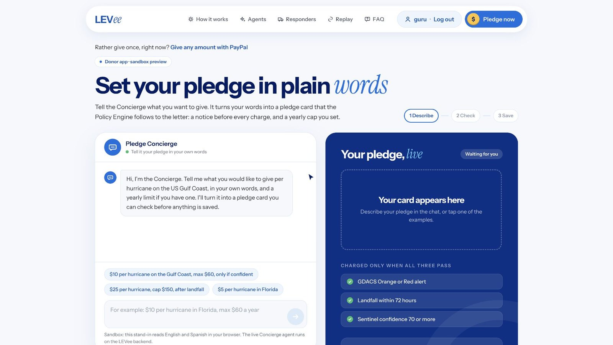</a>

</div>

<div align="center">

### [▶ Watch the 3-minute demo on YouTube](https://youtu.be/SCKDH2wnVVg)

</div>

---

## Contents

- [The problem](#the-problem)
- [How LEVee works](#how-levee-works)
- [A walk through LEVee](#a-walk-through-levee)
- [Why PayPal is essential](#why-paypal-is-essential)
- [How AI is used](#how-ai-is-used-and-what-its-not-allowed-to-do)
- [The published rules](#the-published-rules)
- [Architecture](#architecture)
- [Run it yourself](#run-it-yourself)
- [Safety and limits](#safety-and-limits)

---

## The problem

After a hurricane, donations pour in. But the people who can do the most good, the local groups who evacuate families, stock water and move people to shelter, need money **before** landfall. That's when almost nothing arrives.

Forecasters often see a storm coming days in advance, and humanitarian work on *anticipatory action* shows that acting on a forecast protects more people for less money than responding afterwards. What's missing is a way for ordinary donors to fund that early action safely: money that moves on a forecast, to people who are vetted, with proof afterwards, and without anyone having to trust an AI with their money.

## How LEVee works

| | Step | What happens |
|:-:|---|---|
| 1 | **Pledge once** | A donor says what they'd give, in their own words: *"$10 per hurricane on the Gulf Coast, max $60 a year."* The Concierge agent turns it into a pledge card, and the donor saves their PayPal account once. Nothing is charged. |
| 2 | **A storm meets the rules** | Sentinel reads every official forecast advisory (GDACS, the National Hurricane Center, GloFAS river forecasts, news) and scores how likely the storm is to hit. The Policy Engine checks three fixed rules. |
| 3 | **Notice, then charge** | Every donor gets a notice with a one-tap **Skip this storm** before anything is charged. Then PayPal charges 40% of the pledge from the saved account. |
| 4 | **Paid before landfall** | The Allocator proposes how to split the money between vetted responders, with its reasons. The engine checks the split, and PayPal Payouts sends each responder its share. A sponsor's match is invoiced through PayPal. |
| 5 | **Proof, then the rest** | After landfall, responders upload receipts and photos. The Verifier checks them. The remaining 60% goes only to partners whose proof passed, and anything doubtful waits for a person. |
| 6 | **The donor sees what their money did** | An impact receipt shows where every cent went, with the PayPal reference for each charge and payout. The donor can ask *"Where did my $10 go?"* and the Narrator answers from their own PayPal records. |

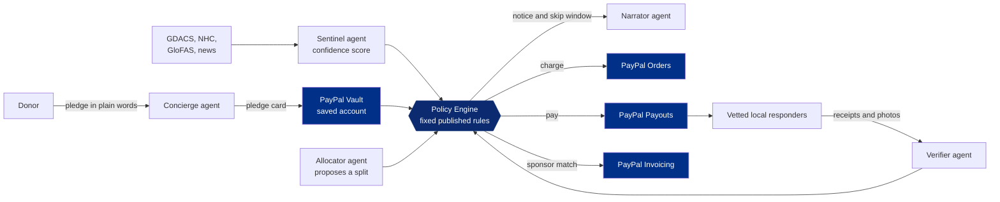

**The one rule that matters: AI proposes, rules decide.** No agent can move money. Only the Policy Engine calls PayPal to charge or pay, and only when its fixed rules pass.

---

## A walk through LEVee

Everything below is the real app on the PayPal **sandbox**, replaying Hurricane Helene (September 2024) from its real forecasts.

<table>
<tr>
<td width="50%">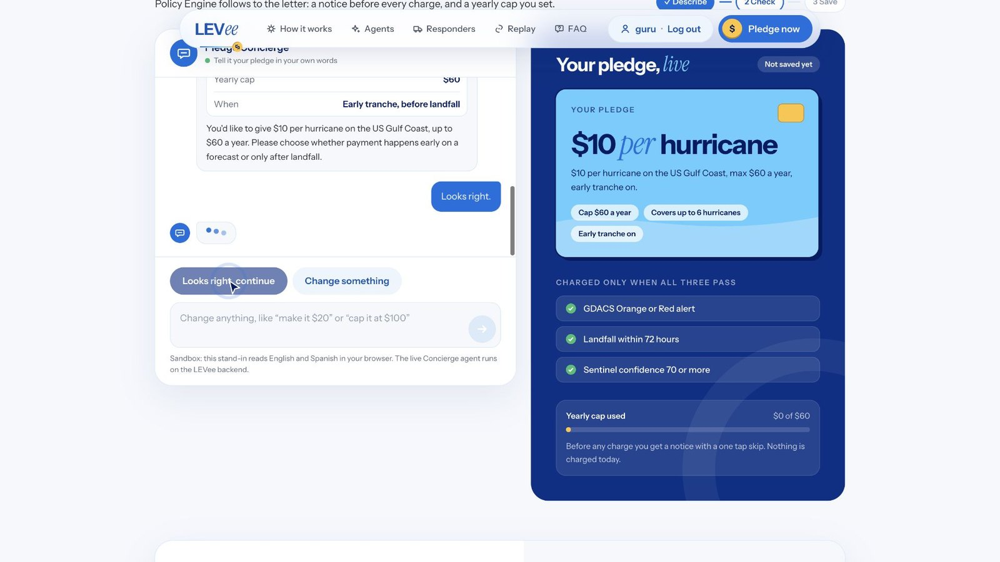<br><b>Pledge in plain words.</b> The Concierge agent turns the donor's words into a pledge card with a yearly cap. The donor checks it before anything is saved.</td>
<td width="50%">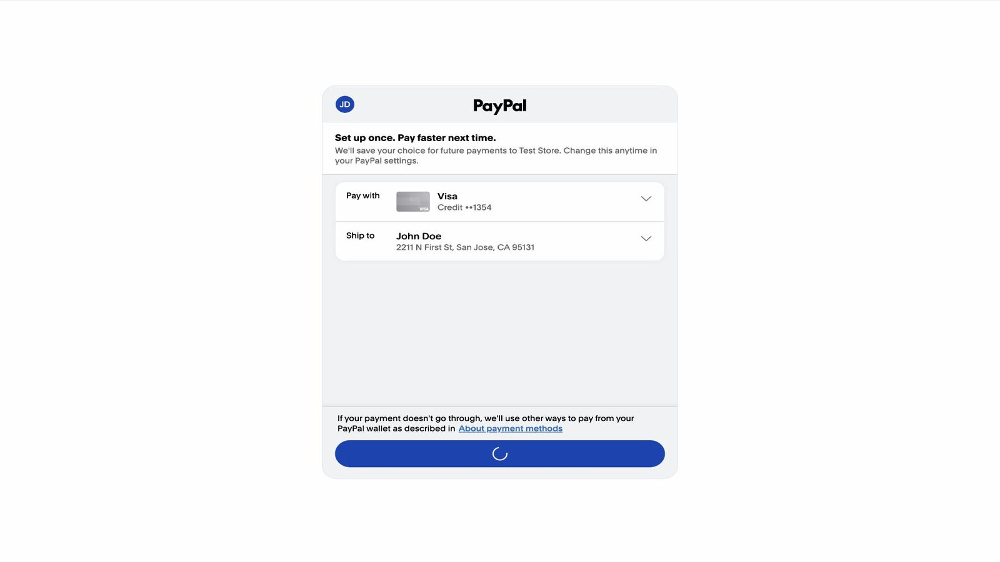<br><b>PayPal's own window.</b> The donor saves their PayPal account with PayPal Vault. LEVee never sees card details, only a token it may charge later under the published rules.</td>
</tr>
<tr>
<td>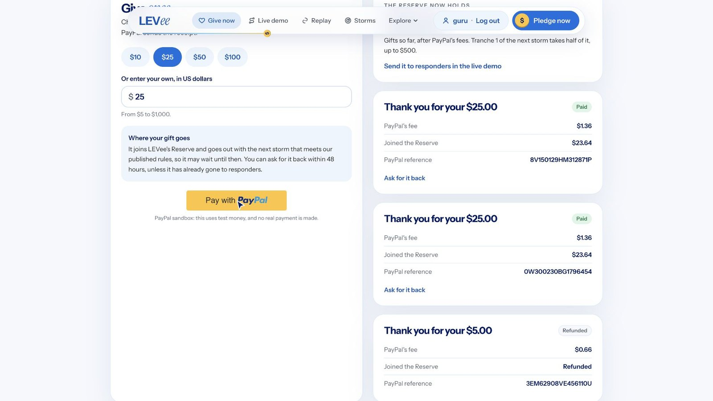<br><b>Or give once.</b> Any amount through PayPal Checkout. The gift joins a shared Reserve for the next storm, and a refund stays open for 48 hours.</td>
<td>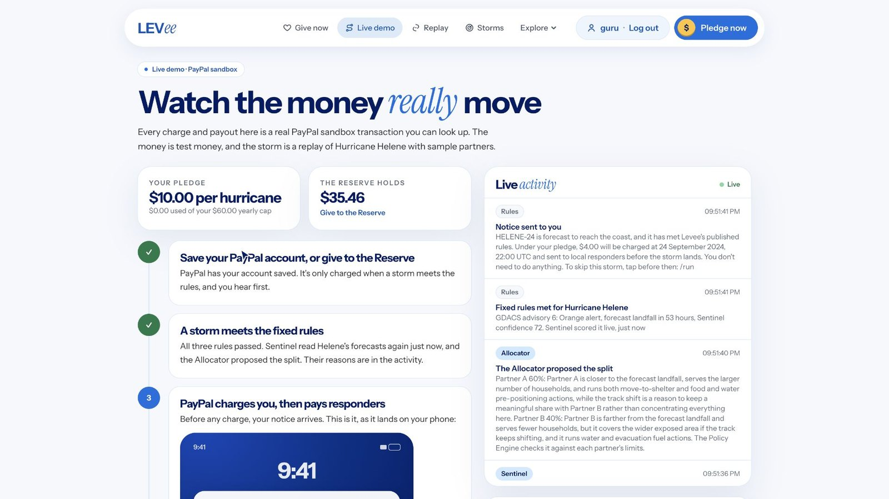<br><b>Watch the money move.</b> The live demo replays Helene through the real Policy Engine, with real sandbox charges and payouts. The activity feed shows every agent, rule and PayPal call.</td>
</tr>
<tr>
<td>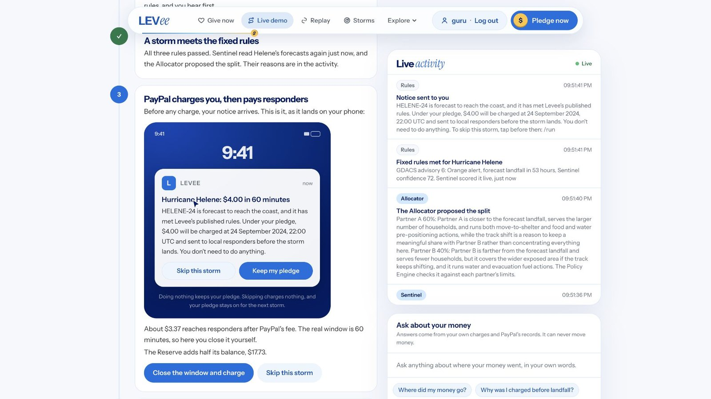<br><b>A notice before every charge.</b> The donor hears what's about to happen, with a one-tap skip, before PayPal charges anything.</td>
<td>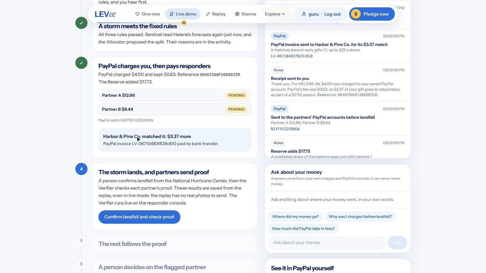<br><b>Paid before landfall.</b> PayPal charges $4 and pays both partners 53 hours before Helene made landfall. Harbor &amp; Pine Co. matches the gift, invoiced and paid through PayPal Invoicing.</td>
</tr>
<tr>
<td>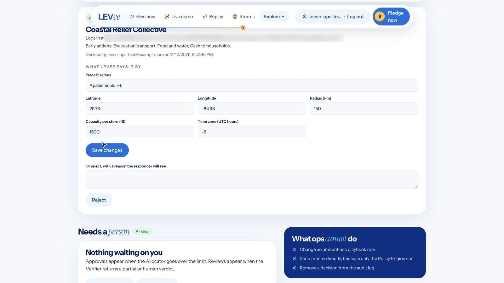<br><b>A person approves every responder.</b> Responders sign up with their PayPal account. Ops checks each organisation and sets where it serves before it can ever be paid. Ops can't change amounts or move money.</td>
<td>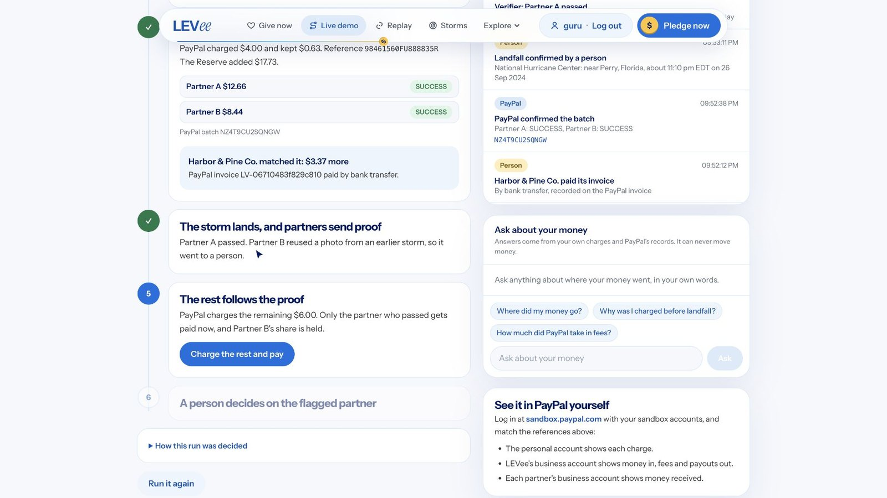<br><b>Proof, checked after landfall.</b> The Verifier checks receipts and photos. Partner A passes. Partner B reused a photo from an earlier storm, so a person decides.</td>
</tr>
<tr>
<td>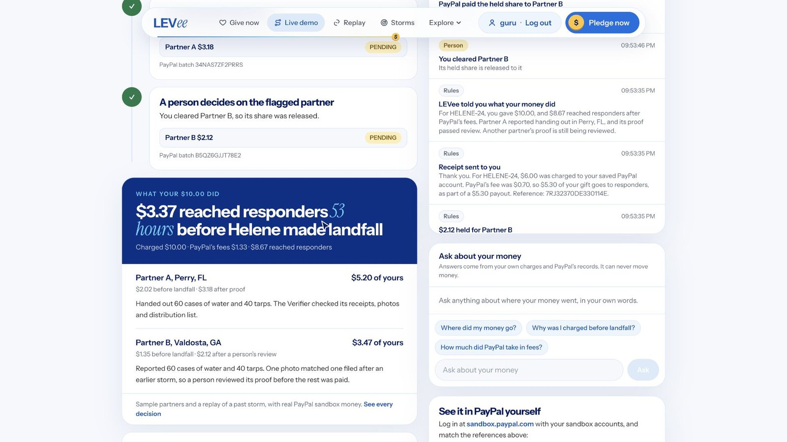<br><b>What your money did.</b> $3.37 of a $10 pledge reached responders 53 hours before landfall, with every fee and every PayPal reference shown.</td>
<td>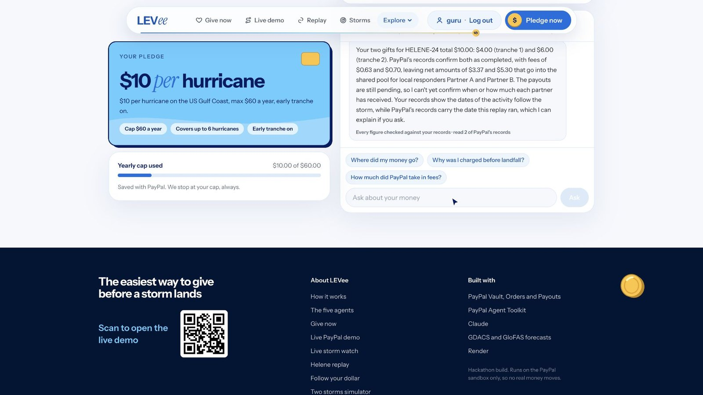<br><b>Ask in plain words.</b> The Narrator answers "where did my money go?" from the donor's own PayPal records. Every figure it writes is checked against the ledger first.</td>
</tr>
<tr>
<td>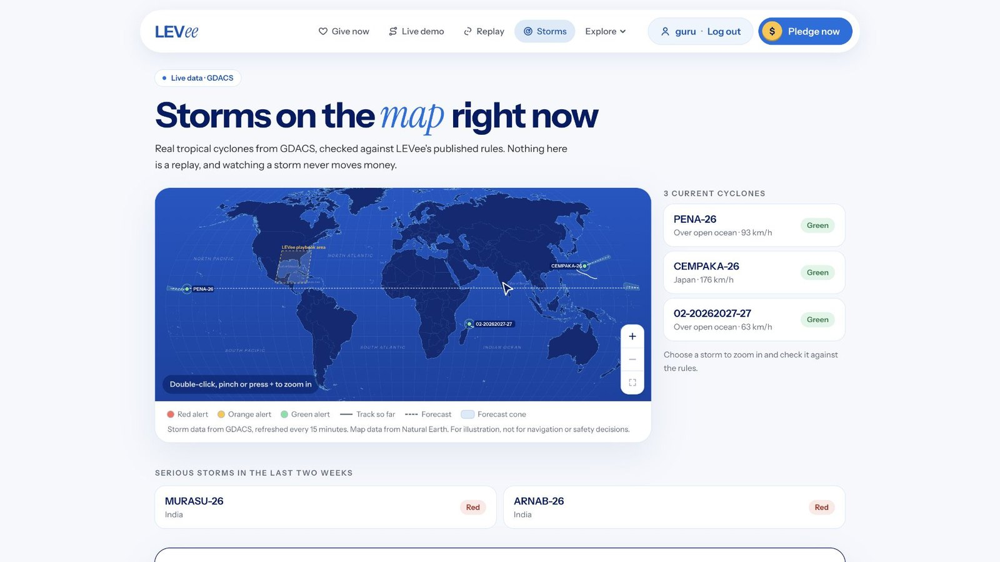<br><b>Today's real storms.</b> Live tropical cyclones from GDACS, checked against the published rules. Reading a storm never moves money.</td>
<td>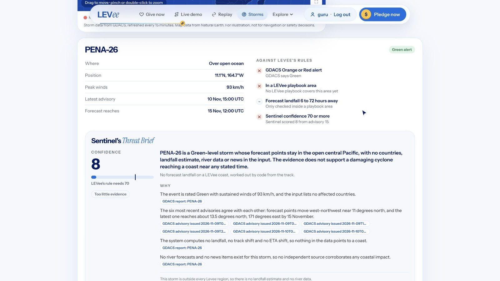<br><b>Sentinel's threat brief.</b> A confidence score with a source cited for every claim, and what the brief cost: under a tenth of a cent.</td>
</tr>
<tr>
<td>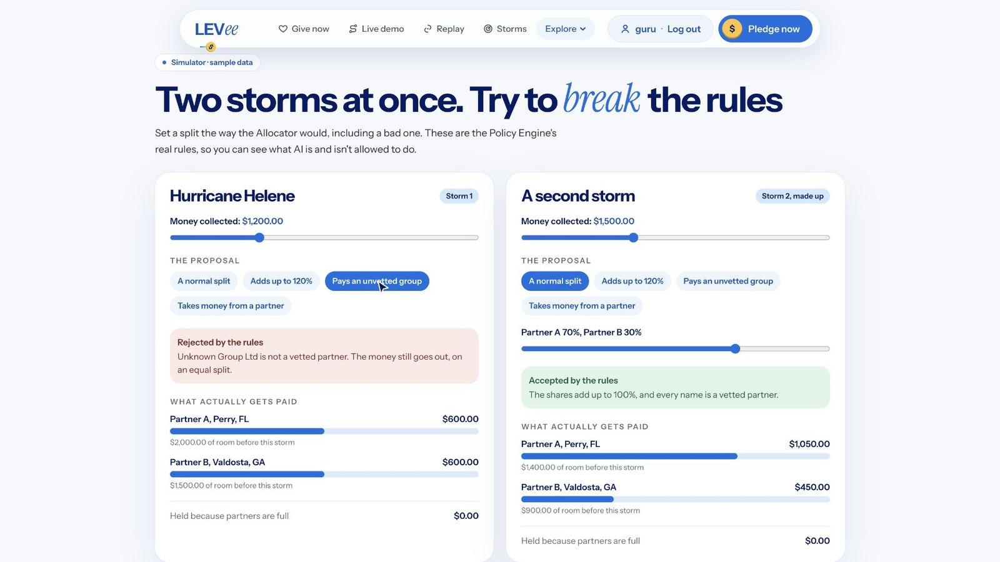<br><b>Try to break the rules.</b> Give the Policy Engine a bad split, such as paying a group nobody vetted, and it's refused. The money goes out as an equal split instead.</td>
<td>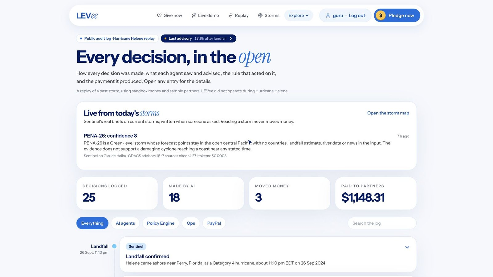<br><b>Every decision in the open.</b> The public audit log shows what each agent saw and advised, the rule that acted on it, and the payment it produced.</td>
</tr>
</table>

---

## Why PayPal is essential

LEVee only works if money can be **promised now and moved later, automatically, the moment a forecast crosses a line**, to small local groups, with a receipt for every cent. PayPal covers that whole loop, with one kind of account for donors, responders and sponsors alike. LEVee uses eight PayPal products, each for a job the idea can't do without:

| PayPal product | API | What LEVee does with it | Why it's essential |
|---|---|---|---|
| **Vault** (save a payment method) | `v3/vault/setup-tokens`, `v3/vault/payment-tokens`, JS SDK v6 | The donor saves their PayPal account once, in PayPal's own window | The heart of LEVee. A storm can cross the line at 3 a.m. for the donor: the charge has to happen **without them there**, and only under the rules they agreed to |
| **Orders** | `v2/checkout/orders`, capture | Each tranche charges the saved account; one-time gifts go through PayPal Checkout | Every charge has a PayPal reference the donor can find in their own PayPal account |
| **Payouts** | `v1/payments/payouts` | Sends each responder its share, in one batch, straight to its PayPal account | Small local groups can't wait days for a bank wire. The money has to land **before landfall** |
| **Invoicing** | `v2/invoicing/invoices`, send, record payment | Invoices a corporate sponsor for its match, then pays the match on | Companies match gifts with a proper invoice and records, not a side deal |
| **Subscriptions** | `v1/billing/subscriptions` | A monthly gift to the shared Reserve | Keeps a pool ready before the season, so the first storm doesn't wait for pledges |
| **Refunds** | `v2/payments/captures/{id}/refund` | A donor can take a charge back within 48 hours | Trust: a donor who changes their mind gets their money back, by rule |
| **Webhooks** | `v1/notifications/verify-webhook-signature` | Confirms charges, payouts and refunds, checking PayPal's signature | The ledger matches what PayPal actually did, not what the app hoped |
| **Agent Toolkit** | `@paypal/agent-toolkit` | Gives the agents **read-only** PayPal tools: transactions, orders, refunds, invoices | The Narrator answers from real PayPal records, and no agent is ever handed a tool that moves money |

The donor, the responders and the sponsor each just use **their own PayPal account**. Nobody has to take LEVee's word for where the money went: every step has a PayPal reference they can check themselves.

---

## How AI is used, and what it's not allowed to do

Five Claude agents, all on `claude-haiku-5-5`, each with one narrow job. They read, judge and write. **They never decide a payment.**

| Agent | Its job | What it can't do | If it fails or says no |
|---|---|---|---|
| **Sentinel** | Reads every forecast advisory, river forecast and news item, and scores 0–100 how likely the storm is to hit the coast, citing a source for every claim | Fire a charge. Its score is one of three rules the engine checks | Nothing fires. The next hourly check tries again |
| **Allocator** | Proposes how to split a tranche between vetted partners, with its reasons | Pay anyone unvetted, change the total, or go over a partner's capacity. The engine refuses it | The engine uses an equal split |
| **Verifier** | Checks partners' receipts and photos after landfall: totals, dates, reused or edited images | Release money on its own. Doubtful proof goes to a person | Nothing is paid until a person decides |
| **Concierge** | Turns a donor's own words into a pledge card | Save anything. The donor confirms the card first | Nothing is saved |
| **Narrator** | Writes notices and receipts, and answers "where did my money go?" from the donor's PayPal records | State a number that isn't in the ledger. Every figure is checked before the donor sees it | Plain text written by code |

**Guardrails built into the code**

- **Code works out every number that matters.** Claude only judges, and any amount Claude writes is checked against the ledger before anyone sees it.
- **Read-only PayPal tools.** Agents get PayPal Agent Toolkit tools that only read. Charges, payouts and refunds run only through the Policy Engine.
- **Replays can't see the future.** Sentinel gets a snapshot of exactly what was known at each advisory, so a replayed storm is judged as it was at the time.
- **Cheap by design.** A whole Hurricane Helene run costs about **$0.035** of Claude, and stops itself at $0.25. A live storm brief costs under a tenth of a cent, and is cached per advisory with a daily cap.
- **A visible label wherever AI wrote something**, in the app and in the audit log, with the model, the tokens used and the cost.

---

## The published rules

The rules are fixed in advance and shown to donors, so anyone can read exactly when money moves. They live in one file: [`backend/policy/src/playbook.ts`](backend/policy/src/playbook.ts).

| Rule | Value |
|---|---|
| Tranche 1 fires when | the GDACS alert is **Orange or Red**, landfall is forecast **within 72 hours** (and at least 6 hours away), and Sentinel's confidence is **70 or more** |
| Tranche 1 charges | **40%** of each early donor's pledge. The rest is tranche 2, after landfall |
| Notice before any charge | a **60-minute** skip window |
| A person approves | any tranche over **$1,000** in total, and every responder before it can be paid |
| The most one partner gets | **$2,000** per tranche, and never more than its stated capacity |
| Proof deadline | **24 hours** after landfall. Unverified shares wait for a person |
| Refunds | open for **48 hours** after a charge |
| The Reserve | gives **50%** of its balance to a storm's tranche 1, up to **$500** |

---

## Architecture

```
LEVee/
├── backend/                 payments, rules and AI: plain TypeScript, no framework
│   ├── payments/            PayPal: Vault, Orders, Payouts, Invoicing, Subscriptions, Refunds, Webhooks, Agent Toolkit
│   ├── policy/              the Policy Engine and the published playbook: the only code that moves money (no AI inside)
│   └── agents/              the five Claude agents, and createLevee, which connects them to the engine
│       └── fixtures/        recorded forecasts and sample proof for Hurricane Helene and Cyclone Remal (2024)
├── frontend/                the website (Next.js 15, React 19, Tailwind 4)
│   └── src/
│       ├── app/             pages, and the server's API routes under app/api
│       ├── components/      the UI, one folder per page
│       ├── server/          connects the API routes to the backend; accounts and storage
│       └── lib/             shared helpers, including the PayPal calls the website makes
├── supabase/migrations/     database tables and account profiles
├── DEPLOY.md                deploying on Vercel
└── docs/screenshots/        the images in this README
```

| Part | Built with |
|---|---|
| Payments | PayPal REST APIs (sandbox), PayPal JS SDK v6, `@paypal/agent-toolkit` |
| AI | Anthropic Claude (`claude-haiku-5-5`) through `@anthropic-ai/sdk`, with a `zod` schema for every agent's output |
| Rules | A pure TypeScript Policy Engine, with no AI inside |
| Website | Next.js 15 (App Router), React 19, Tailwind CSS 4, Motion |
| Accounts and storage | Supabase (Postgres and Auth): donors, responders and ops, each with their own pages |
| Storm data | GDACS, the US National Hurricane Center, GloFAS river forecasts, and news feeds |

More detail: [`backend/README.md`](backend/README.md) covers the agents, the wiring, the API routes and every setting, and [`frontend/README.md`](frontend/README.md) covers the website.

---

## Run it yourself

**You need Node 24 or newer.** The backend runs TypeScript directly, with no build step.

```bash
npm run setup     # installs the backend's three parts and the website
npm run check     # type checks, lints and runs every test, with no keys needed
npm run dev       # the website at http://localhost:3000
```

The site opens with **no keys at all**: the pages stay open without accounts, payments run as a preview, and the pledge chat uses a reader in the browser. To use the real PayPal sandbox and live AI, copy each `.env.example` and fill it in:

| File | Copy from | What goes in it |
|---|---|---|
| `frontend/.env.local` | `frontend/.env.example` | PayPal sandbox app, two partner sandbox accounts, Supabase project, Anthropic API key |
| `backend/payments/.env` | `backend/payments/.env.example` | PayPal sandbox app, webhook and Reserve plan |
| `backend/agents/.env` | `backend/agents/.env.example` | Anthropic API key |

For accounts, run the two SQL files in `supabase/migrations/` in your Supabase project's SQL editor.

**Deploying:** LEVee deploys to Vercel as one project. Follow [`DEPLOY.md`](DEPLOY.md).

**Pages worth opening**

| Page | What it shows |
|---|---|
| `/` | What LEVee is, and the same storm funded two ways |
| `/pledge` | Pledge in plain words, then save your PayPal account |
| `/give` | Give once through PayPal. The gift joins the Reserve |
| `/run` | The live demo: Hurricane Helene from pledge to proof, with real sandbox charges and payouts |
| `/live` | Today's real storms, with Sentinel's live briefs |
| `/replay/helene` | The Helene replay, advisory by advisory |
| `/donor` | A donor's own pledge, notices, PayPal receipts and impact |
| `/ops`, `/responder` | Ops approving responders and proof; a responder's own storms, money and proof uploads |
| `/simulate`, `/track`, `/transparency`, `/audit` | Try to break the rules, follow one gift, the open books, and every decision |

**Tests:** 423 in all (payments 86, policy 80, agents 212, website 45). None need keys or a network.

---

## Safety and limits

- **Sandbox only.** Every payment is in the PayPal sandbox. The code refuses live PayPal keys, so a mistake can't move real money.
- **Sample partners.** Partners A and B and the sponsor Harbor & Pine Co. are samples. LEVee did not operate during Hurricane Helene; the storm is replayed from its real forecasts.
- **One region so far:** the US Gulf Coast. Adding a region means publishing a new playbook.
- Known limits are listed openly at the end of [`backend/README.md`](backend/README.md#known-limits).

<div align="center">
<br>

**AI advises. Fixed rules decide. PayPal pays.**

</div>
